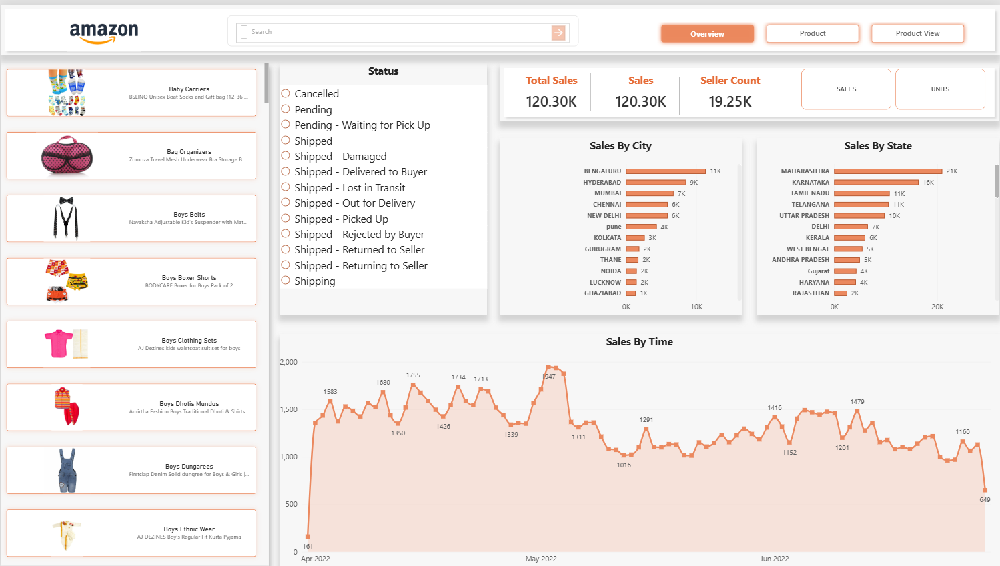
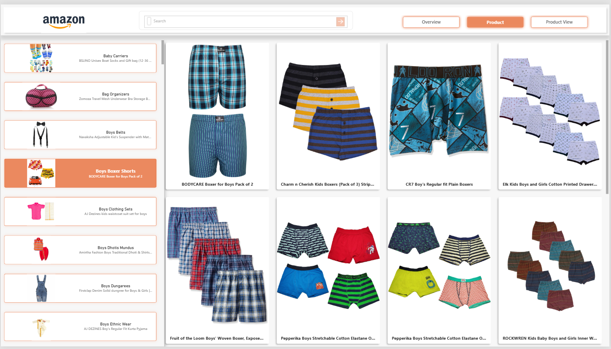
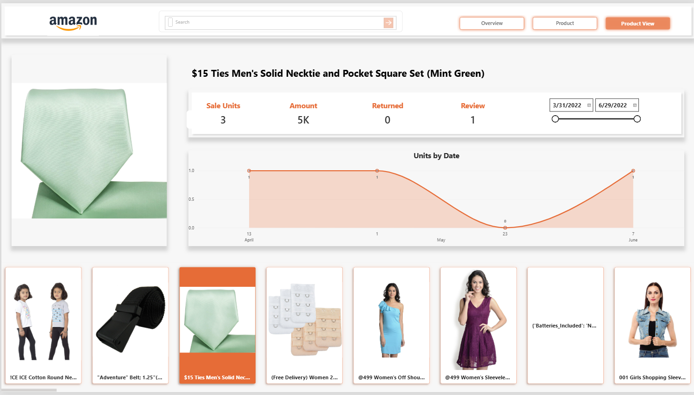
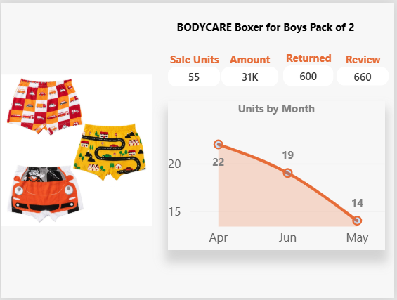

# Amazon Sales & Product Performance Analysis

An interactive Power BI dashboard that analyses Amazon fashion sales by state, city, order status, and product. The project combines interactive visualisations with business analysis, key findings, and actionable recommendations.



## Project Objective

The objective of this project is to analyse Amazon fashion sales data, identify geographical and product-level sales patterns, evaluate order-status performance, and highlight data-quality issues that could affect business decisions.

## Dashboard Preview

| Product | Product View |
|---|---|
|  |  |

### Product Tooltip



## Project Overview

The report covers **31 March to 29 June 2022 (91 days)** and combines headline KPIs, geographical sales analysis, daily sales trends, and product-level drill-down capabilities.

The dashboard consists of four pages:

| Dashboard Page | Description |
|---|---|
| **Overview** | Sales KPIs, sales by city and state, order-status slicer, daily sales trend, and Sales/Units toggle. |
| **Product** | Category selection and image-led product gallery. |
| **Product View** | Individual product KPIs, date range slicer, units by date, and related products. |
| **Product_Tooltip** | Hidden interactive tooltip displaying product KPIs and monthly units. |

## Business Questions

This project aims to answer the following business questions:

1. What is the overall sales performance from April to June 2022?
2. Which states and cities generate the highest sales?
3. How concentrated is sales demand across geographical markets?
4. What do order statuses indicate about potential fulfilment issues?
5. How do individual products perform over time?
6. Which dashboard metrics and data-quality issues require further investigation?

## Key Performance Indicators (KPIs)

| KPI | Value |
|---|---:|
| Total Sales (unfiltered) | 120.30K |
| Seller Count | 19.25K |
| Average Daily Sales | Approximately 1,320 |
| Peak Daily Sales | 1,947 (early May 2022) |
| Available Order Statuses | 13 (including 6 failure or return statuses) |

*Note: KPI definitions, units, currency, and calculation logic should be verified before using these figures for business decisions.*

## Key Findings

### 1. Geographical Sales Concentration

Maharashtra leads with approximately 21K in sales (17.5%), followed by Karnataka with approximately 16K (13.3%). The top three states contribute approximately 40% of total sales, while the top five account for around 57%.

### 2. Sales Concentration in Major Cities

The leading cities are Bengaluru (approximately 11K), Hyderabad (9K), Mumbai (7K), Chennai (6K), and New Delhi (6K). Together, these five cities contribute approximately 32% of total sales.

Kerala and Andhra Pradesh have no cities in the top 12, suggesting that their sales are distributed across a larger number of smaller cities.

### 3. Daily Sales Trends

Daily sales peaked at 1,947 in early May 2022, followed by a decline of approximately 48% within two weeks to a low of 1,016.

From late May through June, daily sales generally remained between approximately 1,000 and 1,480. The highest labelled June day was approximately 16% below the highest labelled April day.

### 4. Order Status and Fulfilment Risk

The dataset includes statuses such as Cancelled, Lost in Transit, Damaged, and Returned.

However, the current dashboard primarily uses order status as a filter and does not provide a dedicated visualisation of the status distribution. Therefore, fulfilment performance and cancellation or return rates require further analysis.

### 5. Product-Level Performance

Product performance varies considerably.

- **BODYCARE Boxer for Boys Pack of 2:** 55 units sold, with approximately 31K in sales.
- **Ties Necktie and Pocket Square Set:** 3 units sold, with approximately 5K in sales.

The BODYCARE Boxer recorded 22 units in April, 14 in May (a 36% decrease), and 19 in June.

## Business Recommendations

Based on the dashboard findings, the following actions are recommended:

1. **Validate KPI definitions:** Verify the calculation logic for Returned, Review, and Seller Count.
2. **Improve fulfilment monitoring:** Add order-status distribution charts and calculate delivered, cancellation, and return rates.
3. **Prioritise key markets:** Focus inventory planning and delivery performance on the highest-performing states and cities.
4. **Investigate sales fluctuations:** Compare the daily sales trend with promotional campaigns and stock availability to understand the May sales spike.
5. **Improve product analysis:** Introduce category and product rankings to distinguish high-volume products from lower-performing products.
6. **Improve data consistency:** Standardise city and state names and clearly label units and currency across all KPI cards.

## Known Issues and Next Steps

The following issues were identified during dashboard review:

| # | Issue | Evidence | Suggested Improvement |
|---|---|---|---|
| 1 | Returned and Review appear inconsistent with units | One product shows 55 units, but Returned = 600 and Review = 660. | Verify the underlying measure definitions and aggregation logic. |
| 2 | Incorrect month sorting | Tooltip displays April, June, May. | Sort the month field using the month number. |
| 3 | Partial date coverage | First day shows 161 and last day shows 649. | Investigate partial days and exclude or annotate them where appropriate. |
| 4 | Inconsistent text casing | Values such as "pune" appear alongside uppercase names. | Standardise city and state text values. |
| 5 | Duplicate sales cards | Total Sales and Sales both display 120.30K. | Clarify their purpose or distinguish all-data sales from current-selection sales. |
| 6 | Undefined Seller Count | Seller Count displays 19.25K without a clear definition. | Document and validate the measure. |
| 7 | Missing units and currency | Sales and amount metrics do not clearly communicate their units. | Add appropriate labels and currency formatting. |

## Tools & Technologies

- **Microsoft Power BI Desktop:** Dashboard development and interactive visualisations.
- **DAX:** Measures and calculations, including `All_Overall_Sale`, `Filter_Sale`, `Seller_Count`, `Sale_Amount`, `Sale_Units`, and `Review`.
- **Power Query and Data Model:** Data preparation and modelling using `Amazon`, `amazon-fashion - YT`, and `Sale_Option`.
- **Git and GitHub:** Version control, project management, and documentation.

## Repository Structure

```text
Amazon-Sales-Performance-Analysis/
│
├── README.md
│
├── PowerBI/
│   └── Amazon Sales Dashboard.pbix
│
├── Documentation/
│   ├── Amazon Sales Dashboard — Business Analysis Report.pdf
│   └── Technical_Dashboard_Review.md
│
└── Screenshots/
    ├── 1.OVERVIEW.PNG
    ├── 2.PRODUCT.PNG
    ├── 3.PRODUCT_VIEW.PNG
    └── 4.TOOLTIP.PNG
```

## How to Use

1. Download the Power BI report (`.pbix`) from the `PowerBI` folder.
2. Install and open [Microsoft Power BI Desktop](https://www.microsoft.com/en-us/power-platform/products/power-bi/desktop).
3. Open the downloaded PBIX file.
4. Use the available slicers, filters, and interactive visuals to explore sales and product performance.
5. Navigate between the Overview, Product, and Product View pages.

## Project Documentation

Additional project documentation is available below:

- [Business Analysis Report](Documentation/Amazon%20Sales%20Dashboard%20%E2%80%94%20Business%20Analysis%20Report.pdf)
- [Technical Dashboard Review](Documentation/Technical_Dashboard_Review.md)

---

**Project:** Amazon Sales & Product Performance Analysis  
**Tool:** Microsoft Power BI  
**Author:** Haris Ali Paracha  
**GitHub:** [Haris2969](https://github.com/Haris2969)
